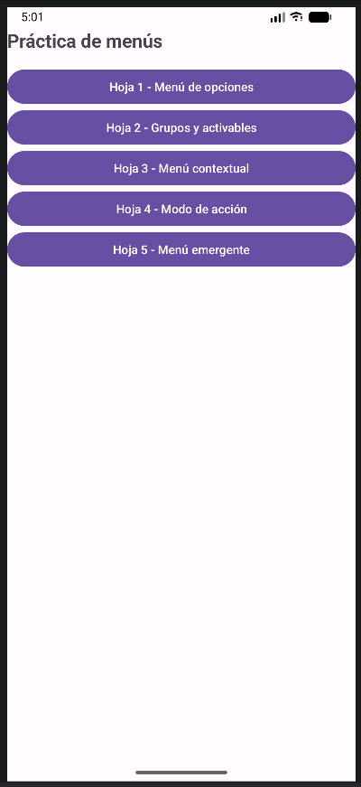
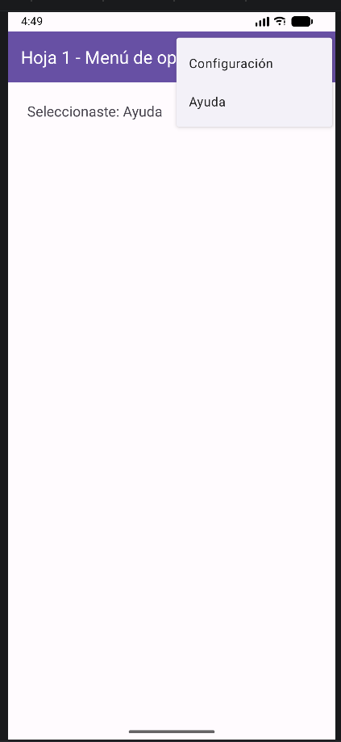
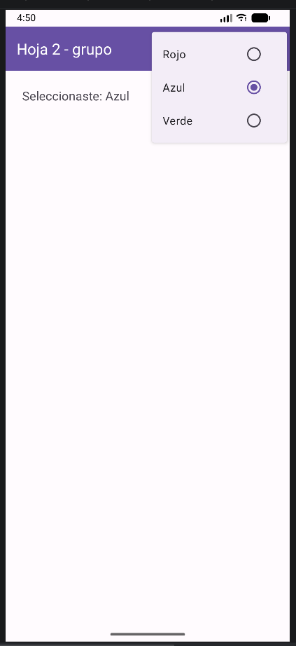
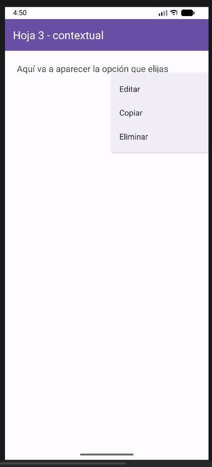
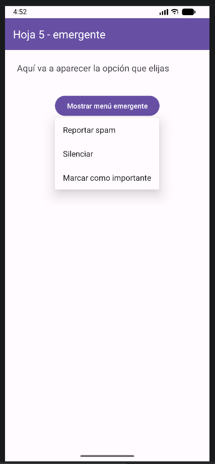

# Práctica: Menús en Android

* **Alumno:** Alma Ariadne Maldonado Eslava
* **Matrícula:** 251028
* **Asignatura:** Desarrollo de Aplicaciones Móviles

## Evidencias de funcionamiento

### Práctica de menús

### 1. Menú de opciones

### 2. Grupos y elementos activables

### 3. Menú contextual flotante

### 4. Modo de acción contextual

### 5. Menú emergente (PopupMenu)
